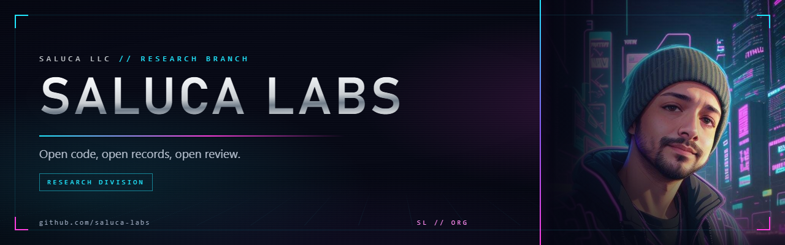

# saluca-labs/.github

Org-level files for [Saluca Labs](https://github.com/saluca-labs): the profile README that renders
on the org page, the shared artwork, and the generator that produced it. This repo holds no
product code. It is the shopfront.

## Status

Live. `profile/README.md` renders at [github.com/saluca-labs](https://github.com/saluca-labs).

Nothing here is versioned, packaged or released. The repo exists so that GitHub has one place to
read the org profile from and so that a per-repo header can be hotlinked without a commit in any
product repo.

## Install

Nothing to install to use this repo: the profile and the images are read straight from the default
branch.

To regenerate the art:

```bash
python -m pip install playwright pillow
python -m playwright install chromium
```

## Quickstart

Put a header at the top of any Saluca Labs repo README with one line, replacing `<repo>` with that
repo's name:

```markdown

```

`HEAD` resolves to whatever the default branch is, so a branch rename does not break the links.

## Usage

| Path | What it is |
|---|---|
| [`profile/README.md`](profile/README.md) | The org page profile. GitHub renders this at `github.com/saluca-labs`. |
| `assets/banner.png` | Header banner, 1280 x 400. |
| `assets/social-preview.png` | Org social preview, 1280 x 640, a triptych of the three portraits. |
| `assets/readme/<repo>.jpg` | Per-repo README header, 1200 x 300, one for each of the 18 public repos. |
| `assets/portraits/` | The three portraits and the Saluca shield that the art is built from. |
| `tools/cardgen.py` | The generator. Renders HTML and CSS with Playwright at exact pixel size. |
| `tools/org_repos.json` | The repo metadata the generator ran against, so a rerun is reproducible. |

## Architecture

GitHub reads this repo by convention, not by call:

1. `profile/README.md` on the default branch is rendered as the organization profile at
   `github.com/saluca-labs`. Nothing else is consulted for that page.
2. Root-level files here (`SECURITY.md`, `CONTRIBUTING.md`, `CODE_OF_CONDUCT.md`, issue and pull
   request templates) become org-wide defaults for every repo that does not carry its own. Today
   only the profile is present.
3. `assets/readme/<repo>.jpg` is not read by GitHub at all. It is fetched by the `raw` URL that a
   product repo's README points at, which is why a header can change here without a commit there.

The generator is a single file. It holds a palette, a portrait family per repo and a one-line blurb
per repo, builds a page of HTML for each card, and screenshots it at the card's exact size.

```text
tools/org_repos.json  --.
assets/portraits/*     --+--> cardgen.py --> social/<repo>.png   1280x640  (Settings upload)
                          |                 readme/<repo>.png   1200x300  (README header)
                          |                 org/profile-banner.png
                          '--------------- org/social-preview.png
```

## Citation

There is no DOI for this repo and it should not be cited. Cite the research repo, or its concept
DOI, that you actually used.

## License

No license is granted for the artwork. The generator script in `tools/` is available to read.

## Links

- [Saluca Labs organization](https://github.com/saluca-labs)
- [saluca.com](https://www.saluca.com)
- [open-review](https://github.com/saluca-labs/open-review) for our own review of our own work

_Last updated: 2026-10-23_
